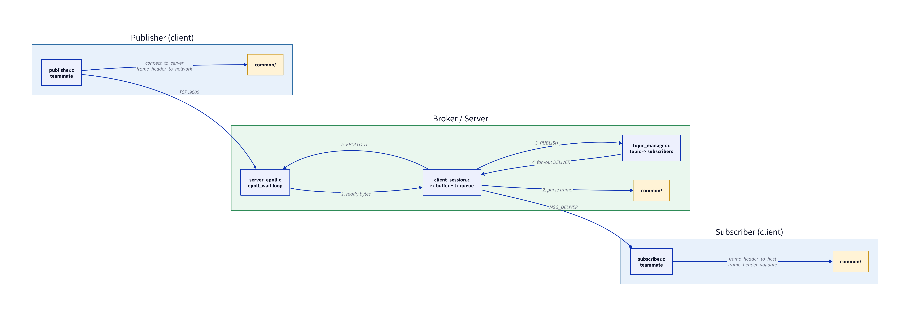

# Phần Common — Publish/Subscribe Communication Framework

**Môn:** IT4062 — Lập trình mạng · **Đề tài 16** · **Người phụ trách:** module `common/`

---

## 1. Tổng quan đề tài

Đề tài yêu cầu xây dựng một **message broker** theo mô hình **Publish/Subscribe** trên TCP, dùng **epoll** (I/O multiplexing) để phục vụ nhiều client bằng một luồng duy nhất.

Mô hình gồm 3 loại tiến trình:

| Vai trò | Mô tả |
|---|---|
| **Broker (server)** | Trung tâm. Nhận kết nối, quản lý topic, nhận `PUBLISH` và phân phối (`DELIVER`) cho mọi subscriber của topic đó. |
| **Publisher** | Client chỉ gửi dữ liệu vào topic. Không biết ai đang nghe. |
| **Subscriber** | Client đăng ký topic và nhận dữ liệu. Không biết ai đang gửi. |

Điểm mấu chốt: publisher và subscriber **không liên lạc trực tiếp** với nhau — chúng chỉ biết broker. Đây chính là ý nghĩa của "publish–subscribe": **decoupling** (tách rời) về không gian (không cần biết địa chỉ của nhau), về thời gian (không cần online cùng lúc) và về luồng xử lý.



---

## 2. Phân chia công việc trong nhóm

Repo được chia theo thư mục, mỗi thư mục là một "vùng trách nhiệm" riêng:

```
include/                 <- hợp đồng (API) dùng chung, cả nhóm cùng đọc
├── protocol.h           [COMMON - tôi]
├── buffer.h             [COMMON - tôi]
├── network_utils.h      [COMMON - tôi]
├── client_session.h     [SERVER]
├── server_epoll.h       [SERVER]
└── topic_manager.h      [SERVER]

src/
├── common/              [COMMON - TÔI PHỤ TRÁCH]
│   ├── protocol.c
│   ├── buffer.c
│   └── network_utils.c
├── server/              [SERVER]
│   ├── main.c           khởi động, parse tham số, cài signal handler
│   ├── server_epoll.c   vòng lặp epoll_wait, accept, dispatch sự kiện
│   ├── client_session.c vòng đời 1 kết nối + hàng đợi gửi (slow consumer)
│   └── topic_manager.c  bảng topic -> danh sách subscriber, fan-out
└── client/              [CLIENT]
    ├── publisher.c      CLI gửi tin, benchmark
    └── subscriber.c     CLI nhận tin, giả lập slow consumer
```

**Vai trò của `common/`:** đây là **lớp nền (foundation layer)**. Cả server và 2 client đều `#include` cùng những header này và link cùng những object file này. Nhờ vậy:

- Chỉ có **một** định nghĩa duy nhất của "một frame trên dây" → server và client không thể hiểu lệch nhau.
- Chỉ có **một** chỗ xử lý byte order, một chỗ cấp phát buffer → sửa bug một lần là sửa cho cả 3 chương trình.
- Teammate làm server/client chỉ cần gọi hàm, không phải viết lại `htons`, `fcntl`, `getaddrinfo`…

Nói cách khác: nếu `common/` sai thì **toàn bộ hệ thống sai**; nếu `common/` đúng thì mọi phần khác chỉ còn là logic nghiệp vụ.

---

## 3. Phần của tôi: 3 module

### 3.1 `protocol.c` — Định nghĩa "một frame" trên đường truyền

#### Vấn đề

TCP là **byte stream**, không phải message stream. Nếu publisher `write()` 3 lần liên tiếp, subscriber có thể `read()` được 1 lần 3 frame gộp lại, hoặc 3 lần mỗi lần nửa frame. Không có "ranh giới tin nhắn" nào cả. Vì vậy ta phải tự định nghĩa ranh giới: **length-prefixed framing** — gửi kèm độ dài trước nội dung.

#### Thiết kế header 12 byte

```c
#pragma pack(push, 1)
typedef struct {
    uint16_t magic;        /* 0x5053 = 'P','S'  */
    uint8_t  version;      /* 0x01              */
    uint8_t  msg_type;     /* MSG_PUBLISH, ...  */
    uint16_t topic_len;    /* độ dài topic      */
    uint16_t status_code;  /* 200, 400, 429 ... */
    uint32_t payload_len;  /* độ dài payload    */
} frame_header_t;          /* sizeof == 12      */
#pragma pack(pop)
```

Bố cục trên dây:

```
 offset  0        2      3       4        6        8              12
        +--------+------+-------+--------+--------+---------------+
        | magic  | ver  | type  | topic_ | status | payload_len   |
        | 2 byte | 1 B  | 1 B   | len 2B | 2 B    | 4 byte        |
        +--------+------+-------+--------+--------+---------------+
        | topic (topic_len byte, không có '\0')                     |
        +-----------------------------------------------------------+
        | payload (payload_len byte)                                |
        +-----------------------------------------------------------+
```

**Vì sao `#pragma pack(1)`?** Struct C có thể bị compiler chèn padding cho canh lề. Nếu không pack, `sizeof(frame_header_t)` có thể là 12 trên máy này nhưng 16 trên máy khác → hai bên hiểu khác nhau, hỏng toàn bộ giao thức. `pack(1)` buộc bố cục chính xác từng byte, và test có kiểm tra `sizeof(...) == FRAME_HEADER_SIZE`.

**Vì sao có `magic`?** Nếu một peer gửi rác (hoặc ta bị lệch frame do bug), việc đọc `magic` sai ngay lập tức cho biết "ta đã mất đồng bộ khung". Không có magic thì ta sẽ `malloc` theo một `payload_len` rác → có thể treo hoặc ăn hết RAM.

#### Bốn hàm cốt lõi

| Hàm | Việc nó làm |
|---|---|
| `frame_header_init()` | Điền header theo **host byte order** (giá trị "người" đọc được). |
| `frame_header_to_network()` | `htons`/`htonl` các trường nhiều byte → dạng **big-endian** để gửi đi. |
| `frame_header_to_host()` | `ntohs`/`ntohl` chiều ngược lại sau khi nhận. |
| `frame_header_validate()` | Kiểm tra magic, version, msg_type hợp lệ, `topic_len ≤ 256`, `payload_len ≤ 1 MB`. |

#### Byte order — chi tiết dễ mất điểm

Intel x86 là **little-endian**: số `0x5053` nằm trong RAM là `53 50`. Chuẩn mạng là **big-endian**: phải là `50 53`. Nếu quên `htons`, server Intel sẽ hiểu `0x5350` ≠ `0x5053` → mọi frame bị từ chối. Trường 1 byte (`version`, `msg_type`) không cần đổi. Trường 4 byte (`payload_len`) phải dùng `htonl` chứ không phải `htons`.

**Nguyên tắc bắt buộc cả nhóm tuân theo:**

- Bên **gửi**: `init` → `to_network` → `memcpy` header + topic + payload → `write`.
- Bên **nhận**: đọc đủ 12 byte → `to_host` → `validate` → mới tin `topic_len`/`payload_len` để đọc tiếp.

#### Frame thật (hexdump từ chương trình test)

Gửi `PUBLISH` tới topic `weather/hanoi`, payload `{"temp":31}`:

```
50 53 01 07 00 0D 00 C8 00 00 00 0B   |  header 12 byte
77 65 61 74 68 65 72 2F 68 61 6E 6F 69 |  "weather/hanoi" (13 byte)
7B 22 74 65 6D 70 22 3A 33 31 7D       |  {"temp":31} (11 byte)
```

Đọc ngược lại: `50 53` = magic "PS", `01` = version, `07` = `MSG_PUBLISH`, `00 0D` = topic dài 13, `00 C8` = status 200 (OK), `00 00 00 0B` = payload dài 11. Tổng frame = 12 + 13 + 11 = **36 byte**.

#### Bảng mã message (trích `protocol.h`)

| Mã | Tên | Chiều | Ý nghĩa |
|---|---|---|---|
| `0x01` | `CONNECT` | C→S | Đăng ký `client_id` + vai trò |
| `0x02` | `CONNACK` | S→C | Chấp nhận kết nối |
| `0x03`/`0x04` | `SUBSCRIBE`/`SUBACK` | C↔S | Đăng ký topic / xác nhận |
| `0x05`/`0x06` | `UNSUBSCRIBE`/`UNSUBACK` | C↔S | Huỷ đăng ký |
| `0x07` | `PUBLISH` | C→S | Gửi tin vào topic |
| `0x08` | `DELIVER` | S→C | Phân phối tin cho subscriber |
| `0x09`/`0x0A` | `LIST_TOPICS`/`TOPIC_LIST` | C↔S | Liệt kê topic đang hoạt động |
| `0x0B`/`0x0C` | `PING`/`PONG` | C↔S | Heartbeat giữ kết nối |
| `0x0D` | `DISCONNECT` | C→S | Ngắt kết nối êm |
| `0x0E` | `ERROR` | S→C | Lỗi giao thức/nghiệp vụ |

Mã trạng thái: `200` OK, `201` CREATED, `400` BAD_REQUEST, `401` INVALID_MAGIC, `402` INVALID_VERSION, `404` TOPIC_NOT_FOUND, `413` PAYLOAD_TOO_LARGE, `429` SLOW_CONSUMER, `500` SERVER_ERROR.

---

### 3.2 `buffer.c` — Bộ đệm byte chống phân mảnh TCP

#### Vấn đề

Một frame 36 byte có thể đến theo kiểu: `read()` #1 trả 8 byte, `read()` #2 trả 28 byte. Hoặc ngược lại, 5 frame gộp thành 1 lần `read()` 180 byte. Nếu code server làm `read(fd, &hdr, 12)` rồi tin ngay đó là header thì sẽ sai ngay khi mạng bận.

Giải pháp chuẩn: **luôn đọc vào buffer, chỉ parse khi đã đủ byte**.

#### Cấu trúc

```c
typedef struct {
    uint8_t *data;      /* vùng nhớ động              */
    size_t   capacity;  /* tổng sức chứa              */
    size_t   read_pos;  /* đầu vùng còn đọc được      */
    size_t   write_pos; /* đầu vùng còn ghi được      */
} byte_buffer_t;
```

Bố cục tuyến tính (không phải ring buffer):

```
data[0 ......... read_pos ......... write_pos ......... capacity)
      đã xử lý     |<- readable ->|   |<- writable ->|
```

- `readable = write_pos - read_pos` → số byte chưa parse
- `writable = capacity - write_pos` → chỗ trống liền sau

Chọn **linear + compaction** thay vì **ring buffer** là có chủ ý: dữ liệu của một frame luôn **liền mạch** trong RAM, nên parse chỉ cần `memcpy` một phát, không phải xử lý trường hợp frame bị "quấn vòng" qua cuối mảng — đây là nguồn bug kinh điển của ring buffer. Đổi lại phải `memmove` khi compact, nhưng chi phí đó rất nhỏ so với lợi ích về độ đơn giản.

#### Cơ chế tăng trưởng 2 tầng

`buffer_ensure_writable(buf, len)` làm theo thứ tự:

1. Còn đủ chỗ ở đuôi? → dùng luôn (0 chi phí).
2. Không, nhưng tổng dung lượng còn đủ? → **compact**: `memmove` vùng readable về offset 0. (Không cấp phát.)
3. Vẫn không đủ? → **realloc** với capacity nhân đôi (256 → 512 → 1024…) cho đến khi đủ. Nhân đôi để chi phí `realloc` được **khấu hao** (amortized O(1)) thay vì O(n) mỗi lần append.

Bước 2 là điểm quan trọng: nếu chỉ có bước 3 thì một luồng dữ liệu liên tục sẽ làm buffer phình vô hạn dù dữ liệu cũ đã parse xong.

#### API

| Nhóm | Hàm | Ghi chú |
|---|---|---|
| Vòng đời | `buffer_create` / `buffer_free` / `buffer_reset` | `reset` chỉ đưa con trỏ về 0, **không** free → tái sử dụng cho kết nối sau |
| Truy vấn | `buffer_readable_bytes` / `buffer_writable_bytes` / `buffer_read_ptr` / `buffer_write_ptr` | |
| Ghi | `buffer_ensure_writable` / `buffer_append` / `buffer_commit_write` | `commit_write` dùng khi `read()` ghi trực tiếp vào `write_ptr` |
| Đọc | `buffer_consume` / `buffer_compact` | `consume` tự clamp, `consume` hết thì rewind về 0 |

#### Mẫu sử dụng trong server (ingress)

```c
/* 1. Đảm bảo có chỗ, rồi đọc thẳng vào buffer */
buffer_ensure_writable(s->rx_buffer, 4096);
ssize_t n = read(fd, buffer_write_ptr(s->rx_buffer), 4096);
if (n > 0) buffer_commit_write(s->rx_buffer, (size_t)n);

/* 2. Chỉ parse khi đã đủ 12 byte header */
while (buffer_readable_bytes(s->rx_buffer) >= FRAME_HEADER_SIZE) {
    frame_header_t wire, hdr;
    memcpy(&wire, buffer_read_ptr(s->rx_buffer), FRAME_HEADER_SIZE);
    frame_header_to_host(&wire, &hdr);
    if (!frame_header_validate(&hdr)) { /* đóng kết nối */ }

    size_t need = FRAME_HEADER_SIZE + hdr.topic_len + hdr.payload_len;
    if (buffer_readable_bytes(s->rx_buffer) < need) break;  /* chờ thêm */

    /* ... xử lý frame ... */
    buffer_consume(s->rx_buffer, need);
}
```

Điều kiện `while` + `break` khi chưa đủ chính là cách xử lý **cả** fragmentation (frame đến lắt nhắt) **và** coalescing (nhiều frame một lần đọc).

---

### 3.3 `network_utils.c` — Thiết lập socket

| Hàm | Việc nó làm | Vì sao cần |
|---|---|---|
| `set_nonblocking(fd)` | `fcntl(F_SETFL, O_NONBLOCK)` | Server đơn luồng: một `read`/`write` blocking sẽ treo **toàn bộ** broker. |
| `set_tcp_nodelay(fd)` | `setsockopt(TCP_NODELAY)` | Tắt Nagle. Nagle gộp các gói nhỏ để tiết kiệm băng thông → thêm delay cho mỗi `DELIVER`. Broker ưu tiên latency. |
| `set_socket_buffer_size(fd, snd, rcv)` | `SO_SNDBUF` / `SO_RCVBUF` | Cho phép hấp thụ burst lớn hơn trước khi `write` trả `EAGAIN`. |
| `create_server_socket(host, port, backlog)` | `getaddrinfo` → `socket` → `SO_REUSEADDR` → `bind` → `listen` → non-blocking | `SO_REUSEADDR` cho phép restart server ngay sau crash, không phải chờ `TIME_WAIT` (~60 s). Trả về `-1` nếu mọi địa chỉ đều fail. |
| `connect_to_server(host, port)` | `getaddrinfo` → vòng `socket`/`connect` qua từng kết quả | Thử lần lượt IPv4/IPv6 nên `localhost`, `127.0.0.1`, `::1`, tên miền đều chạy. |

Chi tiết đáng nói: cả hai hàm dùng `getaddrinfo()` với `AF_UNSPEC` thay vì hard-code `AF_INET` + `inet_pton()`. Nhờ đó cùng một binary chạy được trên IPv4 và IPv6 mà không cần `#ifdef`. Với `create_server_socket`, `AI_PASSIVE` cho phép `host = NULL` nghĩa là "lắng nghe trên mọi interface".

Một điểm tinh tế: listener được tạo ở chế độ non-blocking, nên `accept()` có thể trả `EAGAIN`. Trong vòng lặp epoll (level-triggered) điều này không sao — lần `epoll_wait` sau sẽ báo lại. Nhưng nếu ai đó chuyển sang edge-triggered thì **buộc phải** `accept()` trong vòng `while` cho đến khi `EAGAIN`, nếu không sẽ mất kết nối.

---

## 4. Quy trình hoạt động chi tiết (end-to-end)

Giả sử: `sub1` theo dõi `weather/hanoi`, `pub1` gửi nhiệt độ.

### Bước 0 — Khởi động broker

```
./bin/server 9000
  → create_server_socket("0.0.0.0", 9000, SOMAXCONN)
  → epoll_create1(), epoll_ctl(ADD, listen_fd, EPOLLIN)
  → topic_manager_create()   (danh sách topic rỗng)
  → while (running) epoll_wait(...)
```

### Bước 1 — Subscriber kết nối

1. `sub1` gọi `connect_to_server("127.0.0.1", 9000)` → có `sock_fd`.
2. Gửi `CONNECT`, payload = `"sub1"`.
3. Broker: `accept()` → tạo `client_session_t` (`session_create(fd, "sub1")`), gắn `rx_buffer` mới, thêm vào linked list `clients_head`, `epoll_ctl(ADD, EPOLLIN)`.
4. Broker trả `CONNACK` → `sub1` in `[CONNECTED]`.

### Bước 2 — Subscriber đăng ký topic

1. `sub1` gửi `SUBSCRIBE` với `topic = "weather/hanoi"`.
2. Broker parse frame → `topic_subscribe(mgr, "weather/hanoi", session)`:
   - Topic chưa có → tạo node `topic_t` mới.
   - Thêm `sub_node_t` trỏ tới session vào danh sách subscriber của topic.
3. Broker trả `SUBACK` (status 200, `sub_count`).
4. `sub1` in `[SUBACK] Topic 'weather/hanoi': ... (Status: 200)` rồi chuyển sang vòng `read` chờ `DELIVER`.

### Bước 3 — Publisher gửi tin

1. `pub1` gửi `PUBLISH`, topic `weather/hanoi`, payload `{"temp":31}`.
2. Broker: `read()` → `rx_buffer` → `frame_header_to_host` → `frame_header_validate` → `buffer_consume`.
3. `topic_find("weather/hanoi")` → duyệt `subscribers_head`.
4. Với mỗi subscriber: **tái tạo frame `DELIVER`** (header mới, giữ nguyên topic + payload) → `session_enqueue_message()`.
5. Nếu hàng đợi còn chỗ → đẩy vào `tx_head/tx_tail`, bật `EPOLLOUT` (`server_update_client_events(..., true)`).
6. Broker trả ACK cho `pub1` (`200 OK`, số subscriber đã nhận).

### Bước 4 — Phân phối và ghi ra socket

1. `epoll_wait` báo `sub1` **sẵn sàng ghi**.
2. `session_flush_egress(sub1)`: ghi dần từ `sent_offset`, xử lý `EAGAIN` (ghi một phần → giữ `sent_offset`, chờ lần sau), `EINTR` (thử lại).
3. Hàng đợi rỗng → tắt `EPOLLOUT` (tránh busy-loop vì `EPOLLOUT` luôn báo ready khi socket trống).
4. `sub1` `read()` frame → in `[HH:MM:SS] [#1] [TOPIC: weather/hanoi] Payload (11 bytes): {"temp":31}`.

### Bước 5 — Slow consumer (điểm nhấn của đề tài)

Nếu `sub1` chạy với `--delay-ms 500`, nó đọc chậm. Broker vẫn đẩy tin vào hàng đợi:

```
tx_queue_bytes + len > max_queue_bytes (2 MB)?
   ├── không → enqueue, EPOLLOUT
   └── có    → DROP frame, msgs_dropped++, is_slow_consumer = true
               gửi MSG_ERROR status 429 (SLOW_CONSUMER)
```

Đây là **flow control phía ứng dụng**: ta không thể để một subscriber chậm làm broker phình RAM vô hạn (kernel send buffer đầy → `EAGAIN` → queue tăng → OOM). Ngưỡng 2 MB và 500 item là hằng số trong `client_session.h` (`DEFAULT_MAX_QUEUE_BYTES`, `DEFAULT_MAX_QUEUE_ITEMS`).

> Lưu ý phân vai: `session_enqueue_message` / `session_flush_egress` do bạn phụ trách server viết trong `client_session.c`, nhưng chúng **dùng** `byte_buffer_t` và `frame_header_*` của tôi. Đây chính là lý do `common/` phải ổn định trước.

### Bước 6 — Ngắt kết nối

1. `sub1` gửi `UNSUBSCRIBE` cho từng topic → broker gọi `topic_unsubscribe()`.
2. Gửi `DISCONNECT` → broker `topic_unsubscribe_all()`, `epoll_ctl(DEL)`, `session_free()` (giải phóng `rx_buffer`, toàn bộ `egress_item_t`, rồi `close(fd)`).
3. Topic không còn subscriber → xoá khỏi danh sách (tránh rò rỉ bộ nhớ theo thời gian).

---

## 5. Ánh xạ API: ai gọi gì của `common/`

| Hàm trong `common/` | Server | Publisher | Subscriber |
|---|:---:|:---:|:---:|
| `frame_header_init` | ✓ | ✓ | ✓ |
| `frame_header_to_network` | ✓ | ✓ | ✓ |
| `frame_header_to_host` | ✓ | ✓ | ✓ |
| `frame_header_validate` | ✓ | ✓ | ✓ |
| `msg_type_to_str` | ✓ (log) | – | ✓ |
| `status_code_to_str` | ✓ | – | ✓ |
| `buffer_create` / `free` | ✓ (mỗi session) | – | – |
| `buffer_append` | ✓ (build frame) | – | – |
| `buffer_read_ptr` / `consume` | ✓ (parse) | – | – |
| `set_nonblocking` | ✓ (listen + client fd) | – | – |
| `set_tcp_nodelay` | ✓ | ✓ | ✓ |
| `set_socket_buffer_size` | ✓ | – | – |
| `create_server_socket` | ✓ | – | – |
| `connect_to_server` | – | ✓ | ✓ |

---

## 6. Build và kiểm thử

```bash
make            # build toàn bộ (cần đủ file server/ + client/)
make test       # unit test module common (53 assertion)
make asan       # test dưới AddressSanitizer + UndefinedBehaviorSanitizer
make valgrind_test   # nếu máy có valgrind
make clean
```

Kết quả thực tế trên máy:

```
$ make test
===============================================
 Common module unit tests (protocol/buffer/net)
===============================================
[1] byte_buffer: basic lifecycle ............ 12 checks OK
[2] byte_buffer: growth + compaction ........  6 checks OK
[3] protocol: header init / byte order ...... 16 checks OK
[4] protocol: string tables .................  4 checks OK
[5] network_utils: loopback listen/connect .. 15 checks OK
===============================================
 Result: 53/53 checks passed  ->  ALL PASSED
```

Biên dịch với `-Wall -Wextra -Wpedantic -Werror`: **0 warning, 0 error**. Chạy dưới ASan+UBSan: **không leak, không lỗi bộ nhớ, không UB**.

Nội dung `tests/test_framing.c`:

1. **Buffer cơ bản** — tạo, append, consume, over-consume (phải clamp chứ không UB), reset.
2. **Buffer tăng trưởng** — 1000 chu kỳ append/consume xen kẽ (kích hoạt cả compact lẫn realloc), sau đó append 8192 byte một lần; kiểm tra thứ tự dữ liệu còn nguyên.
3. **Protocol** — magic/version/type/length đúng; `to_network` rồi `to_host` phải khôi phục y nguyên (round-trip); `sizeof(header) == 12`; 5 trường hợp header sai đều bị `validate` từ chối; `NULL` bị từ chối.
4. **Loopback thật** — mở listener trên cổng động, connect, gửi **một frame thật** qua TCP, đọc vào `byte_buffer_t`, parse lại và so sánh topic + payload từng byte.

Điểm 4 là quan trọng nhất khi bảo vệ: nó chứng minh chuỗi `init → to_network → write → read → commit → to_host → validate → consume` hoạt động thật trên socket, không chỉ trên giấy.

---

## 7. Những quyết định thiết kế đáng trình bày

| Quyết định | Lý do | Đánh đổi |
|---|---|---|
| Header cố định 12 byte | Parse O(1), biết ngay cần đọc bao nhiêu | Lãng phí vài byte với tin rất nhỏ |
| `#pragma pack(1)` | Bố cục byte chính xác giữa mọi kiến trúc | Truy cập field hơi chậm hơn (không đáng kể) |
| Magic + version | Phát hiện lệch frame / client cũ ngay lập tức | +2 byte/frame |
| Buffer tuyến tính + compact | Frame luôn liền mạch, parse đơn giản | Có `memmove` khi compact |
| Tăng capacity gấp đôi | Amortized O(1), ít `realloc` | Có thể thừa tối đa 2× bộ nhớ |
| `getaddrinfo` thay `inet_pton` | Hỗ trợ IPv4/IPv6/DNS miễn phí | Code dài hơn, có cấp phát |
| `TCP_NODELAY` | Giảm latency cho broker | Nhiều gói nhỏ hơn trên dây |
| `SO_REUSEADDR` | Restart server ngay | Rất hiếm khi che giấu lỗi bind |

---

## 8. Hạn chế và hướng mở rộng

Vì đây là bản demo, một số điểm được giữ đơn giản có chủ ý:

- **Chưa có TLS** — dữ liệu đi dạng plaintext. Thực tế cần TLS hoặc ít nhất là auth token trong `CONNECT`.
- **Chưa nén payload** — tin lớn (>1 MB) bị từ chối với `413` thay vì chia nhỏ. Có thể thêm `MSG_CHUNK` hoặc nén zlib.
- **`MAX_PAYLOAD_LEN` 1 MB** — chọn để chặn tấn công "khai báo length khổng lồ" (`payload_len` rác) làm broker `malloc` hết RAM. Đây là validate **trước khi** cấp phát, rất quan trọng.
- **Không có persistence** — broker restart là mất toàn bộ topic. Có thể thêm `retain` message hoặc lưu ra file.
- **Chưa có wildcard topic** (`weather/*`) — chỉ so khớp chuỗi chính xác.
- **`buffer` không thread-safe** — không cần vì thiết kế là single-threaded epoll. Nếu chuyển sang thread pool thì mỗi session phải có lock riêng.

---

## 9. Câu hỏi thường gặp khi bảo vệ

**H: Vì sao phải tự định nghĩa header mà không gửi struct thẳng?**
Vì struct trong C có padding và byte order phụ thuộc kiến trúc. Gửi thẳng `struct` thì máy little-endian và big-endian (hoặc compiler khác) sẽ hiểu khác nhau. `#pragma pack(1)` + `htons/htonl` là cách chuẩn để có định dạng độc lập nền tảng.

**H: Nếu client gửi `topic_len = 60000` thì sao?**
`frame_header_validate()` từ chối vì `topic_len > MAX_TOPIC_LEN (256)` → server gửi `MSG_ERROR` (status 400/401) và đóng kết nối. Ta **không** `malloc` theo con số client khai báo trước khi validate — nếu làm ngược lại là lỗ hổng DoS.

**H: Vì sao buffer không phải ring buffer?**
Ring buffer tiết kiệm `memmove` nhưng frame có thể bị quấn vòng → parse phải xử lý 2 nhánh (phần đầu mảng + phần cuối mảng), là nguồn bug lớn. Với khối lượng dữ liệu của đồ án, chi phí `memmove` không đáng kể, còn độ rõ ràng thì rất đáng.

**H: `buffer_consume` khi `len > readable` thì sao?**
Clamp về `readable` (tức là reset). Không bao giờ để `read_pos > write_pos` vì khi đó `readable` sẽ underflow thành số `size_t` khổng lồ → crash.

**H: Vì sao `set_nonblocking` là bắt buộc với epoll server?**
Với blocking fd, một `read()` trên kết nối chưa có dữ liệu (hoặc `write()` khi buffer đầy) sẽ treo thread duy nhất → **tất cả** client bị đứng. epoll chỉ báo "sẵn sàng", không đảm bảo "đủ dữ liệu cho một lần đọc trọn vẹn".

**H: Phần của bạn có phụ thuộc vào phần của ai không?**
Không phụ thuộc — `common/` chỉ dùng thư viện chuẩn POSIX, không `#include` header của server/client. Ngược lại, server và client **phụ thuộc** vào `common/`. Đó là lý do tôi hoàn thành và test module này trước để cả nhóm build được.

---

## 10. Tóm tắt một câu

> Phần `common/` định nghĩa **ngôn ngữ chung** của hệ thống: một frame 12 byte có magic/version/length chuẩn hoá byte order (`protocol.c`), một bộ đệm byte tự co giãn để ghép mảnh TCP thành frame hoàn chỉnh (`buffer.c`), và bộ hàm thiết lập socket non-blocking dùng chung cho cả broker lẫn client (`network_utils.c`).
